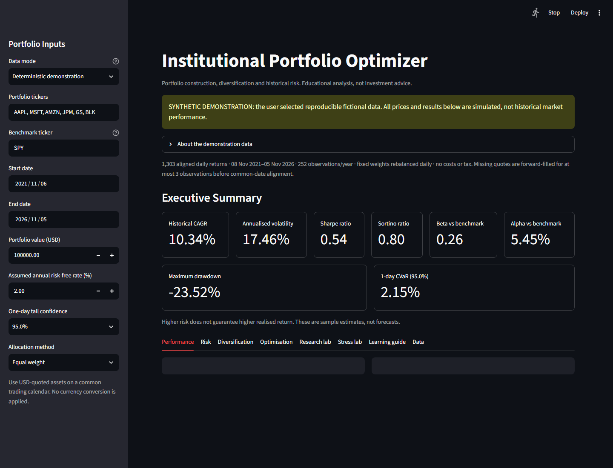
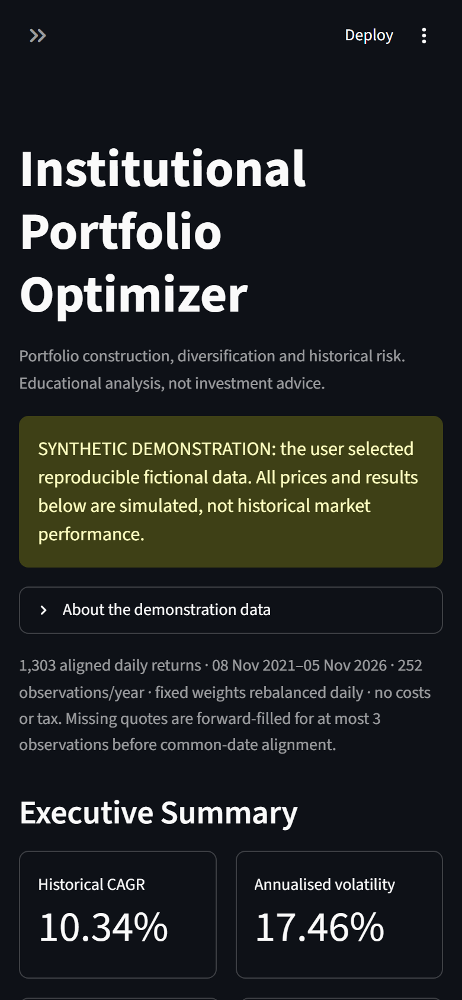

# Institutional Portfolio Optimizer

## Overview

Institutional Portfolio Optimizer is a Python finance analytics project for portfolio construction, risk analysis, and allocation research. It combines market data, portfolio metrics, Monte Carlo simulation, optimisation, and an interactive Streamlit dashboard.

The project is designed for MSc Finance & Data Science / Financial Engineering applications, graduate investment analytics roles, fintech roles, and quantitative finance portfolio review.

This project is for educational and analytical purposes only. It does not provide investment advice.

## Business Problem

Investment teams need to understand the relationship between asset allocation, expected return, volatility, drawdowns, and portfolio risk concentration. This project provides a structured tool for comparing equal-weight, minimum volatility, maximum Sharpe, and simplified Black-Litterman style allocations.

## Key Features

- Reproducible deterministic demonstration mode at launch, visibly labelled as fictional
- Optional historical adjusted-price download using `yfinance`, with synthetic fallback if unavailable
- Daily returns and cumulative returns
- Annualised return and volatility
- Sharpe Ratio and Sortino Ratio
- Separately selected benchmark with aligned beta, Jensen-style alpha, tracking error and information ratio
- Rolling 63-observation volatility, beta, tracking-error and maximum-drawdown diagnostics
- Asset return attribution that reconciles to compounded portfolio return
- Maximum drawdown
- Historical VaR, parametric VaR, and CVaR
- Capital allocation versus risk contribution by asset
- Effective holdings, weight concentration and covariance-based diversification diagnostics
- Correlation heatmap
- Monte Carlo portfolio simulation
- Solved long-only efficient frontier with explicit numerical constraint checks
- Random-allocation opportunity set shown separately for context
- Minimum volatility portfolio
- Maximum Sharpe Ratio portfolio
- Clearly labelled historical-return tilt heuristic (not a Black-Litterman model)
- Streamlit dashboard with portfolio inputs and visual analytics
- Selectable 95%, 97.5% or 99% one-day tail confidence and USD loss equivalents
- Visible synthetic-data warnings, missing-asset notices and optimiser-failure disclosure
- Exportable analysis summary including source, weights and assumptions
- Finance learning guide linking results to BMC and Finance Fundamentals concepts
- Walk-forward Research Lab comparing equal weight, minimum volatility and concentration-capped minimum volatility
- Drift-aware holdings, approximate trading costs, paired block-bootstrap return intervals and reproducible study exports

## Technologies Used

- Python
- pandas
- NumPy
- scipy
- yfinance
- Streamlit
- Plotly
- pathlib

## Project Structure

```text
institutional-portfolio-optimizer/
  README.md
  requirements.txt
  .gitignore
  app.py
  data/
    raw/
    processed/
  src/
    data_generation.py
    preprocessing.py
    modelling.py
    analytics.py
    research_artifacts.py
    visualisation.py
    research.py
  tests/
    test_analytics.py
    test_data.py
    test_app.py
    test_research.py
    test_research_artifacts.py
  docs/
    COURSE_APPLICATIONS.md
    RESEARCH_PROTOCOL.md
  notebooks/
  outputs/
  screenshots/
  assets/
```

## Methodology

1. Download or generate historical price data.
2. Clean prices and calculate daily returns.
3. Calculate portfolio performance, risk, benchmark alpha/beta and rolling diagnostics on aligned observations.
4. Reconcile fixed-weight asset wealth changes to compounded portfolio total return.
5. Solve the minimum-variance frontier across feasible target returns and show random allocations for context.
6. Optimise allocations for maximum Sharpe Ratio and minimum volatility, rejecting numerically invalid solver output.
7. Visualise allocation, risk, attribution, drawdown, correlation, and frontier results in Streamlit.

## How To Run

```bash
pip install -r requirements.txt
python src/data_generation.py
streamlit run app.py
```

The dashboard keeps downloads in memory and does not overwrite the checked-in
price file. The optional data-generation command saves prices alongside
`data/raw/asset_prices.metadata.json`, identifying whether the data is adjusted
market data or a synthetic fallback. Older CSV files without a sidecar have
unknown provenance and must not be assumed to contain genuine market observations.
The dashboard starts in deterministic demonstration mode so a reviewer receives a
responsive, reproducible walkthrough without depending on a third-party provider.
Select `Yahoo Finance adjusted prices` in the sidebar to request market data.

## Applying Finance Learning

The first improvement sprint applies **BMC equities** and **Bloomberg Finance
Fundamentals** to benchmark selection, diversification, risk/reward interpretation
and evidence quality. See [the implementation and learning guide](docs/COURSE_APPLICATIONS.md)
for formulas, worked examples and the next improvements.

Important conventions:

- SPY is the default comparison benchmark; it is no longer automatically invested
  in. Include it explicitly among portfolio tickers if it should also be a holding.
- Portfolio weights are fixed across the displayed sample, implying daily
  rebalancing without costs in the descriptive dashboard. Its optimisation and
  evaluation use the same sample. The separate Research Lab uses strictly earlier
  training returns, periodic rebalancing, drift and approximate costs.
- CAGR is geometric; Sharpe uses arithmetic daily excess returns and a compounded
  daily risk-free rate. Undefined zero-risk ratios display as N/A.
- Sortino uses all observations to calculate downside deviation relative to the
  daily risk-free target, rather than the standard deviation of loss days alone.
- Drawdown includes the original investment, including a loss on the first day.
- VaR uses a linearly interpolated historical quantile. CVaR averages observed
  returns at or below that threshold; ties can alter the number of tail observations.
- Tail metrics are one-day estimates. Positive signs represent losses; they are
  not maximum-loss guarantees or regulatory capital estimates.
- Prices must have a common currency and calendar. The UI assumes USD and performs
  no FX conversion. At least 30 aligned prices are required. Missing quotes are
  forward-filled for at most three observations, then incomplete dates are dropped.
  Returns that would bridge a removed source observation are excluded rather than
  annualised as though they represented one observation.

## Validation

After installing the requirements, run the offline numerical, data-provenance and
Streamlit interaction tests:

```bash
python -m unittest discover -s tests -v
```

Tests use deterministic fixtures and mocked downloads. They do not establish live
provider availability or validate a profitable investment strategy.

## Research Question

**Do concentration limits improve the out-of-sample risk of minimum-volatility
allocations after trading costs, and what return trade-offs do they introduce?**

The Research Lab compares three strategies on the same later observations. The
default experiment uses a 126-observation rolling training window, rebalancing
every 21 observations, a 35% target-weight cap where feasible, and an assumed
10 basis points per traded notional. It reports gross/net performance, risk,
trading volume and exploratory uncertainty intervals for mean return differences.

Download the research bundle for input returns, target weights, training cutoffs,
trade records, settings, a dataset hash and results. Read the
[research protocol](docs/RESEARCH_PROTOCOL.md) before interpreting results.
The first deliverable is an auditable experiment, not a claim of new academic
novelty or superior performance. Synthetic runs demonstrate mechanics only.

## Dashboard screenshots

The default deterministic demonstration has passed desktop and mobile visual
acceptance. These images are generated from the running application, not mockups.





Reproduce both images with `node scripts/capture_screenshots.js` while the app
is running locally and headless Chrome is listening on port 9222. The detailed
acceptance matrix and limitations are recorded in
[docs/VISUAL_ACCEPTANCE.md](docs/VISUAL_ACCEPTANCE.md).

## Results / Insights

The dashboard helps answer:

- Which assets dominate portfolio risk?
- How does a maximum Sharpe allocation differ from equal weights?
- How severe are historical drawdowns?
- Does diversification reduce volatility?
- How sensitive is the portfolio to market benchmark movements?

## Skills Demonstrated

- Quantitative finance analytics
- Portfolio optimisation
- Risk metrics
- Monte Carlo simulation
- Streamlit dashboard development
- Plotly visualisation
- Python package organisation

## Future Improvements

- Full Black-Litterman implementation
- Factor exposure analysis
- More realistic execution, market-impact and cost models beyond proportional fees
- Sector, country, asset-class and currency exposure classification
- Deeper curve, credit-spread and cross-currency stress scenarios beyond the current first-order duration/FX lab
- Point-in-time universe selection and a locked external holdout for confirmatory research
- PDF report export

## Author

Derek Ohimai Isokpehi  
GitHub: [iso-derek](https://github.com/iso-derek)

## Extended allocation and stress research

The Research tab now offers seven walk-forward allocation rules: the original three plus covariance-shrunk minimum variance, shrinkage risk parity, static cash defence and volatility-adaptive cash defence. All decisions use past observations; cash, drift and trading costs are explicit. The Stress lab adds user-specified bond-duration, currency and inflation assumptions.

```bash
python scripts/run_research.py          # explicitly synthetic reproducible study
python scripts/run_research.py --live   # requires complete real adjusted prices
python scripts/run_research.py --input outputs/study_prices.csv  # hash-verified replay
```

See the [extended protocol](docs/RESEARCH_PROTOCOL.md) and [recorded results](docs/RESEARCH_RESULTS.md). A real-data run is now recorded by its frozen-input hash, but the provider data itself is not committed because redistribution rights are not established. The yfinance documentation describes the tool as research/educational and directs users to Yahoo's terms; verify current rights before publishing or commercial use.
# One-command local launch

On Windows with Python 3.13, double-click `Start.cmd`, or run `py -3.13 launch.py` in this folder. Python 3.12 is also supported. See [quick start and research history](docs/QUICKSTART.md).
